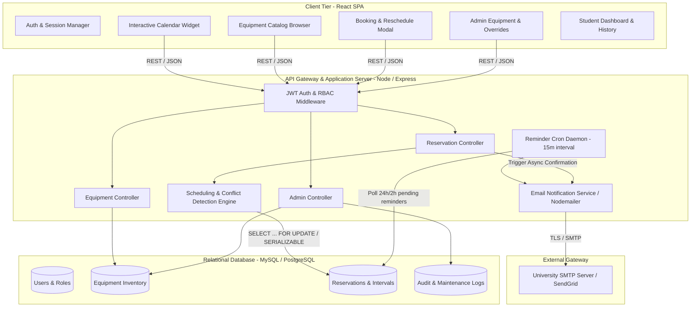
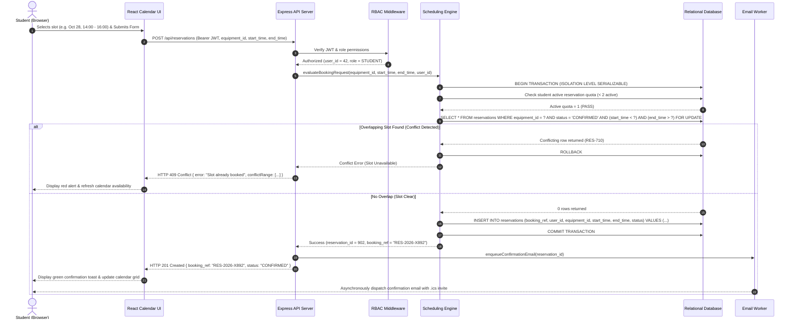
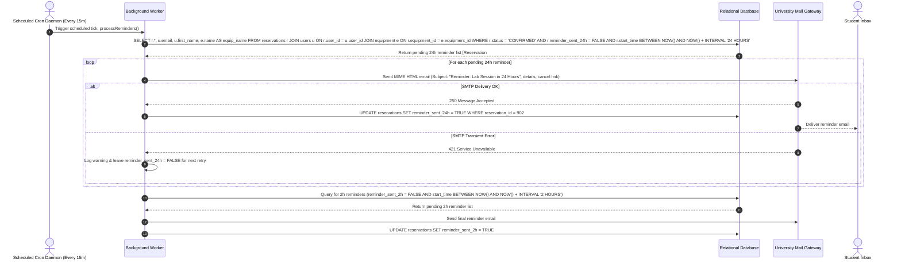
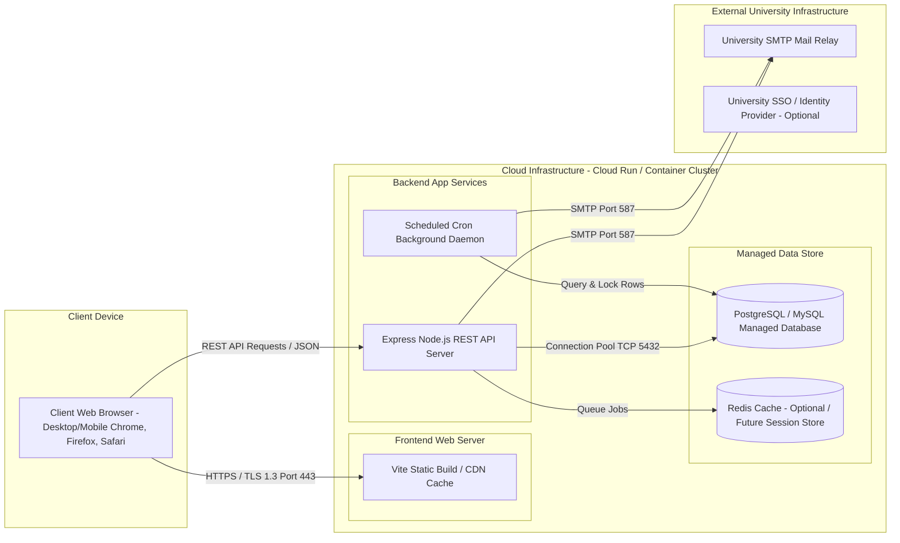
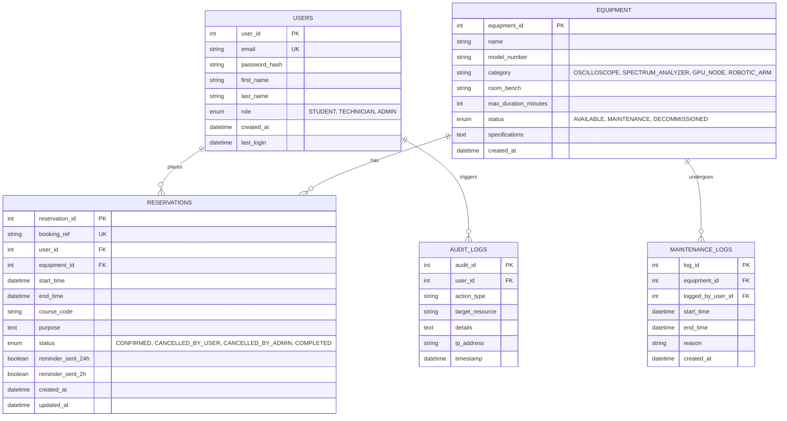

# SYSTEM ARCHITECTURE DOCUMENT (SAD)
## Project: Remote Lab Reservation System (RLRS)
**Standard:** Kruchten 4+1 Architectural Views  
**Version:** 1.0.0-PROD  
**Date:** October 27, 2026  
**Architectural Style:** Layered Client-Server Architecture with RESTful Services & Asynchronous Background Workers  
**Context:** University Software Engineering Mini-Project  

---

## 1. ARCHITECTURAL GOALS, CONSTRAINTS & STYLE

### 1.1 Architectural Goals
- **Zero Double-Booking Guarantee:** The scheduling engine must guarantee atomic interval locking to prevent race conditions during simultaneous user checkouts.
- **Sub-150ms Query Latency:** High throughput interval indexing to permit rapid calendar rendering and conflict validation.
- **Stateless Application Server:** Node/Express API cluster capable of horizontal scaling behind a load balancer.
- **Asynchronous Reliability:** Decoupling user-facing reservation transactions from SMTP email transmissions via background worker queues.

### 1.2 Architectural Constraints
- Single GitHub repository for collaborative university mini-project.
- Multi-environment CI/CD pipeline using GitHub Actions for automated linting, test execution, and deployment.
- Strict RBAC authorization enforcement at the routing middleware layer.

---

## 2. 4+1 ARCHITECTURAL VIEWS

### 2.1 Logical View (Component Diagram)


### 2.2 Process View: Booking & Conflict Detection Sequence


### 2.3 Process View: Automated Email Reminder Flow (24h / 2h Cron)


### 2.4 Physical & Deployment View


### 2.5 Data View: Entity-Relationship Diagram (ERD)


---

## 3. SCHEDULING ENGINE & CONFLICT DETECTION ALGORITHM

### 3.1 Mathematical Interval Formulation
Two time intervals $A = [Start_A, End_A)$ and $B = [Start_B, End_B)$ overlap if and only if:
$$(Start_A < End_B) \land (End_A > Start_B)$$

For an incoming reservation request for equipment $E$ spanning $[T_{reqStart}, T_{reqEnd})$:
```sql
SELECT reservation_id, booking_ref, start_time, end_time 
FROM reservations 
WHERE equipment_id = :equipment_id 
  AND status = 'CONFIRMED'
  AND start_time < :req_end_time 
  AND end_time > :req_start_time
FOR UPDATE;
```

### 3.2 Concurrency & Transaction Isolation
- **Isolation Level:** `SERIALIZABLE` or `READ COMMITTED` with explicit pessimistic row locks (`SELECT ... FOR UPDATE`).
- **Race Condition Prevention:** Any concurrent thread attempting to book the identical unit is blocked at the database engine until the prior transaction commits or rolls back, guaranteeing zero overlapping slots.

---

## 4. RESTFUL API SPECIFICATION

| Method | Path | Auth / Role | Description | Response & Error Codes |
| :--- | :--- | :--- | :--- | :--- |
| `POST` | `/api/auth/login` | All | Authenticates user with university email and password, returning JWT bearer token. | 200 OK, 400 Bad Request, 401 Unauthorized |
| `GET` | `/api/equipment` | Student, Technician, Admin, Faculty | Returns paginated and categorized list of lab equipment with operational status. | 200 OK, 401 Unauthorized |
| `GET` | `/api/equipment/:id/availability` | Student, Technician, Admin, Faculty | Retrieves booked and maintenance timeslots for a given equipment ID within a date window. | 200 OK, 400 Invalid Date Range, 404 Equipment Not Found |
| `POST` | `/api/reservations` | Student, Technician, Admin | Creates a new reservation after executing atomic interval conflict check. | 201 Created, 400 Bad Request, 409 Conflict (Overlap), 422 Quota/Duration Exceeded |
| `GET` | `/api/reservations/me` | Student, Technician, Admin | Retrieves current student's upcoming, past, and cancelled reservations. | 200 OK, 401 Unauthorized |
| `PATCH` | `/api/reservations/:id/cancel` | Student, Technician, Admin | Cancels an upcoming reservation and releases the slot for other users. | 200 OK, 400 Too Close to Start Time, 403 Forbidden, 404 Not Found |
| `PATCH` | `/api/reservations/:id/reschedule` | Student, Technician, Admin | Reschedules an existing reservation to a new non-conflicting time window. | 200 OK, 409 Conflict on New Slot, 422 Invalid Duration |
| `POST` | `/api/admin/equipment` | Technician, Admin | Provisions a new lab hardware unit into the institutional inventory catalog. | 201 Created, 400 Invalid Payload, 403 Forbidden |
| `PUT` | `/api/admin/equipment/:id/maintenance` | Technician, Admin | Flags equipment for maintenance and overrides conflicting student bookings. | 200 OK, 403 Forbidden, 404 Not Found |
| `GET` | `/api/admin/reports/utilization` | Technician, Admin | Computes lab equipment utilization percentage and booking metrics over specified period. | 200 OK, 403 Forbidden |

---

## 5. CI/CD PIPELINE DESIGN (GitHub Actions)

```yaml
name: CI/CD Pipeline - Remote Lab Reservation System
on:
  push:
    branches: [ main, develop ]
  pull_request:
    branches: [ main ]

jobs:
  lint-and-test:
    runs-on: ubuntu-latest
    steps:
      - uses: actions/checkout@v4
      - uses: actions/setup-node@v4
        with:
          node-version: 20
          cache: 'npm'
      - name: Install Dependencies
        run: npm ci
      - name: Code Quality & Lint
        run: npm run lint
      - name: Execute Vitest Suite
        run: npm test -- --coverage
      - name: Stress Test Conflict Engine
        run: npm run test:concurrency
```

---

## 6. REQUIREMENTS TRACEABILITY MATRIX (SAD)

| Requirement ID | Requirement Title | Architectural Component | Tier | Verification Artifact |
| :--- | :--- | :--- | :--- | :--- |
| **FR-01** | User Auth & JWT | Auth Middleware & User Controller | API Gateway | Unit & Integration Tests (TC-01..03) |
| **FR-02** | RBAC Authorization | RoleGuard Middleware | API Gateway | Security Matrix Tests (TC-04..06) |
| **FR-03** | Equipment Catalog | CatalogBrowser & Equipment Controller | Frontend UI | Catalog UI Tests (TC-07..08) |
| **FR-04** | Equipment Inventory | AdminEquipmentModal & DB_Equip | Persistence (DB) | Admin Suite (TC-09..10) |
| **FR-05** | Calendar Availability Widget | CalendarWidget & Availability API | Frontend UI | Calendar Functional Tests (TC-11..13) |
| **FR-06** | Timeslot Booking Request | BookingModal & Reservation Controller | Frontend UI | Booking Happy Path (TC-14..15) |
| **FR-07** | Conflict Detection Engine | SchedulingEngine & Transaction Manager | Scheduling Engine | Concurrency & Overlap Tests (TC-16..20) |
| **FR-08** | Quota & Duration Validator | BookingPolicyValidator | Scheduling Engine | Boundary Tests (TC-21..23) |
| **FR-09** | Reservation Rescheduling | RescheduleController | API Gateway | Reschedule Tests (TC-24..25) |
| **FR-10** | Self-Service Cancellation | CancelBookingController & DB | API Gateway | Cancellation Lockout Tests (TC-26..27) |
| **FR-11** | Confirmation Email + .ics | Nodemailer Service & ICS Generator | API Gateway | Email Mock Tests (TC-28) |
| **FR-12** | 24h & 2h Reminder Cron | ReminderCronDaemon | Cron Worker | Cron Daemon Simulation (TC-29..30) |
| **FR-13** | Admin Force Override | AdminOverrideController | API Gateway | Admin Override Suite (TC-31) |
| **FR-14** | Student Dashboard & History | StudentDashboardView | Frontend UI | Dashboard Render Tests (TC-32) |
| **NFR-01** | Conflict Latency < 150ms | Indexed DB Interval Query | Scheduling Engine | k6 Performance Load Tests |
| **NFR-06** | Zero Double-Booking | SERIALIZABLE Row-lock Engine | Scheduling Engine | Race Condition Stress Suite |

---
*End of System Architecture Document.*
